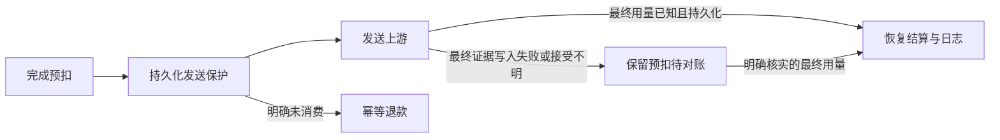

# 网关参考实现复评与修复（2026-09-18）

行为基线为 `2a4158c7184dfbb11ec102285984f8b0dda2941a`。本次修复上一轮复评的六项问题，并将同类账务保护扩展到异步任务接受后失败的路径。所有验证使用本地测试数据和模拟供应商；源码同步与应用容器部署是独立操作。

本文保留 2026-09-18 的历史验证范围。2026-09-19 已移除本站套餐订阅，当前只有钱包资金来源；下文订阅场景仅描述当时版本，不代表现行功能。专属提交和原归档的只读查阅方法见[文档历史追溯](../README.md#历史追溯)，当前行为见[统一路由](UNIFIED_ROUTING.md)。

## 修复范围

| 编号 | 原问题 | 修复后的契约 | 主要实现与回归 |
| --- | --- | --- | --- |
| R1 | 已输出请求最终账务写入失败，恢复任务误退款 | 全部计价模式发送前持久化保护；缺少最终用量不自动退款、不猜测结算金额 | `model/billing_dispatch.go`、`service/billing_dispatch.go`；`TestBillingDispatchGuardLifecycle`、三库集成 |
| R2 | Gemini 补估输出时丢缓存与模态明细 | 深复制原账务快照，只补缺失输出，保留供应商分类和估算来源 | `relaykit/dto/billing_usage.go`；Gemini 宿主和 DTO 回归 |
| R3 | 第一把 Key 的临时错误改变健康 epoch，后续尝试被旧快照阻断 | 每次获槽复核当前可用性；发送前取得本次健康 epoch，观察结果仍受版本约束 | `service/route_runtime.go`、`controller/relay_attempt.go`；`TestGatewayMultiKeyRetryRefreshesHealth` |
| R4 | 末尾候选超价或不能转换，使前方繁忙渠道失去排队机会 | 集中处理候选耗尽后的单次排队，共享原有等待、扫描和发送预算 | `controller/relay.go`；`TestGatewayFilteredTailPreservesBusyQueue` |
| R5 | Responses reasoning 双向映射使用错误的 content 字段 | 标准摘要读写 summary；读取兼容历史 content，summary 优先；流式最终响应采用同一解析规则 | RelayKit Chat/Responses 转换器、golden 和实际宿主 handler 回归 |
| R6 | Gemini 同一帧混合 thought 和正文时，正文进入 reasoning_content | 按 part 独立累计正文与摘要，保留多块文本、工具和原有顺序 | Gemini 转换器、同帧和跨帧不变量及实际 SSE handler 回归 |

R6 在参考 new-api 中同样存在。移植参考代码不能替代协议样本和行为验证。R2 的补估助手也不会把已存在的供应商输出覆盖为本地估计；当没有供应商快照时，才从公共 usage 构建包含缓存和模态的估算快照。

## 账务状态与故障边界

2026-09-18 验证的普通倍率、按次、当时仍存在的订阅、免费和付费零预扣请求都在发送前保存 `usage_pending`，包含当次渠道、模型、价格、附加倍率与额度换算单位；写入失败则禁止发送。表达式请求沿用已有 `pricing_pending` 及冻结表达式，不改变旧记录结构。现行钱包请求继续遵守相同发送保护。

Realtime 保存累计用量时，普通请求转为 `usage_collect`，表达式继续使用 `pricing_collect`。两者表示最终用量尚未确认；进程退出时不能把最后一次累计值当成完整账单。消费快照准备失败只记录错误，保留已有保护状态和证据，不清空快照。



`active` 或 `settled` 中的未确认消费仍计入 `billing_recovery` 积压，但不占自动恢复批次，避免阻塞有充分证据的其他记录。旧 `unprepared` 记录也受保护。已持久化明确退款意图的 `refund_pending` 仍能继续恢复；没有发送或上游明确拒绝的合法退款保留。

任务提交已接受或接受不明时，本地数据库失败、响应缺少任务 ID 或连接中断都不足以证明没有产生任务。通用计费会话复用 `UpstreamSideEffecting` 保护 Task、Midjourney、图片生成、Coze 等路径，阻止退出退款并停止心跳；已有发送保护负责进程结束后的恢复边界。已接收但未保存任务的请求不返回虚假成功、不重放、不生成成功消费日志；必须按已有证据对账。

Replicate 与 Dify 的文件上传是生成前置操作。`UpstreamPreparationOnly` 明确标记尚未发送生成请求：上传失败可退生成预扣，但已创建或接受不明的文件仍不可自动重放。开始发送生成请求前清除此标记，新尝试也不能继承它。进程在这些阶段崩溃后，数据库仍保留发送保护，恢复器不会凭缺少最终证据自动退款。

这些状态使用现有列，不新增表或迁移。它们不能恢复从未成功写入数据库的最终用量或私有任务 ID，也没有新增自动对账入口。不能将旧版恢复 worker 与这些新状态混用；旧版本可能把未知状态当作可退款请求，版本回退必须保留等价保护。

## 三个参考项目的吸收与取舍

结论对应本地固定源码，参考项目未被修改：AxonHub `bd7144ecfcafe661710322287e673b1e86129224`、new-api `69a50029819a26c53e6babd276d49cfe2f8880ad`、sub2api `881f3202694c6bc932446931a30c27d9675178b9`。下列入口位于工作区的 `reference-projects/`，不依赖跟踪参考仓库。

| 项目与机制 | 本次吸收 | 更适合 Ren2Hub 的实现与边界 |
| --- | --- | --- |
| AxonHub `llm/pipeline/middleware.go` 明确 Request 与 Attempt 生命周期 | 一次逻辑请求保留全部真实发送的结果 | 复用 `AttemptOutcome` 和现有 `route_decision`，无需引入另一套 pipeline 或执行记录数据库 |
| AxonHub `internal/ent/schema/request_execution.go` 保存执行状态、耗时等 | 增加可选 `attempts` 列表，跨 compact 重选保留 | 只保存安全字段；不复制请求/响应正文、响应块、供应商错误文本或 Key 后缀。错误状态不冒充真实上游成功 HTTP 状态 |
| AxonHub 渠道 limiter 与首语义输出预读 | 保留明确的尝试资源释放和输出提交边界 | Ren2Hub 已有稳定池身份、原位扩缩容和 FIFO；参考实现配置变化重建 limiter 会让旧在途请求留在旧池，不替换现有实现 |
| new-api `relaykit/dto/billing_usage.go` 供应商账务快照 | 深复制后只补缺项；公共 usage 与账务 sidecar 使用同一结果 | 保留计费方言、缓存、音频/图片/文本、工具及思考计数；只有真正补值时才标记 Estimated |
| new-api Responses 转换器与适配器覆盖 | 标准 summary 字段和双向宿主回归 | 测试以实际 JSON/SSE 契约断言，而不是模仿错误 DTO；共享缺陷 R6 独立修复 |
| sub2api `backend/internal/service/openai_account_scheduler.go` 获槽后刷新账号及再次查询数据库 | 获槽后和发送前复核当前可用性，失效则释放并按既有预算继续 | 区分可变健康事实与固定身份：健康 epoch 变化可以重新判定，Key/端点/权限变化仍不能沿用旧请求身份 |
| sub2api `concurrency_service.go` 批量负载缓存与 singleflight | 采用“缓存仅作预筛、发送依据当前事实”的边界 | 本地容量查询已足够便宜；新增缓存会引入第二份容量事实，不为单实例照搬 Redis 账号池 |
| sub2api 可选高级评分与 WebSocket 分层容量 | 保留为产品需求驱动的后续方向 | 当前硬 priority/position 和 Realtime 整连接持槽是明确契约。没有可比较的线上样本与交互需求，不用延迟评分或每轮槽替换它们 |

### 尝试诊断契约

`route_decision.attempts` 只记录已经实际发送的尝试，序号对应 `upstream_attempts`。价格、转换、容量等发送前拒绝仍留在候选诊断中。一次请求的实际发送数量继续受现有预算限制，不增加无限历史。

字段为 `sequence`、`channel_id`、`success`、`origin`、`latency_ms`、`acceptance`、`retry_permission`、`response_committed`，失败时附带稳定的 `error_class` 和 `error_http_status`。`latency_ms` 是本次处理耗时，包含本轮发送前准备，不能当作纯上游延迟；错误 HTTP 状态来自归一化错误，不保证一定是供应商原始状态。没有从响应头到达推导 TTFT，也没有将成功状态伪造为 200。

旧日志缺少 `attempts` 时仍可读取，原请求级摘要保留。诊断沿用既有有界异步日志队列，队列满时可能丢弃整条事件；它不是持久化账务凭证。

### 未引入的复杂度

Provider Redis 预留脚本仍按窗口内事件汇总额度。源码可确认其遍历成本随事件数增加，但本轮没有真实 Redis 的规模压测，不能声称存在已验证的吞吐瓶颈。后续先测不同窗口规模的脚本延迟，再比较 TPM 关闭时跳过求和、增量计数或时间桶；不能在没有数据时承诺性能提升或改动窗口精度。

逐次诊断也没有扩展为持久化请求/响应追踪系统。当前修复的主要问题是状态过渡和最终证据缺失，继续复用现有单实例准入、转换计划、原生状态归属及账务恢复，避免同时维护两套事实。

## 验证记录

验证环境为 Windows amd64、Go 1.25.1、Python 3.12.14。主模块全量测试已执行；初次失败来自旧测试仍要求未确认消费参与自动恢复，以及未知任务、取消和图片失败后自动退款。按新契约补强断言后，失败包及随后修改的 `service`、`router`、Dify、Replicate、`relay/common` 已完整复验通过，其余未变包沿用本轮通过结果。

竞争检测覆盖模型账务、服务账务与路由、控制器尝试诊断、真实 HTTP 换 Key/备用渠道/排队/身份失效、任务与 MJ 接受状态、图片、前置上传，以及独立 RelayKit 全模块。所有后端命令使用 `-timeout 60s`，没有放宽超时或跳过失败用例。主模块 `go vet`、Windows 与 Linux amd64 构建，以及 RelayKit 的独立测试、`go vet`、`GOWORK=off go build ./...` 均通过。

八套固定版本官方 SDK 验收全部通过、无 SKIP：基础文本、Realtime、Python 语义、TypeScript 语义、媒体、特殊渠道、旧协议和兼容渠道。每套单独使用 60 秒超时；网络仅连接本地模拟供应商。其余 SDK 专项没有重跑，不沿用历史结果充当本轮实测。未修改前端，也未重新执行服务器容器、真实 Redis 压测、整进程强杀或真实供应商验收。

三库场景包括既有 25 项与新增 9 项，共 102 项：普通倍率最终写入失败、按次写入失败、免费零预扣、发送保护写入失败、明确退款、退款恢复、Realtime 累计、订阅和付费零预扣。SQLite、MySQL 5.7.19、PostgreSQL 16.15 都在本地隔离数据库运行，不把缺少连接变量导致的 SKIP 记为通过。

临时 MySQL/PostgreSQL 实例已正常关闭。工作区忽略目录 `tmp/` 保留本次证据：`gateway-review-root-final.log` 是初轮全量结果，`gateway-review-final-packages.log` 是最终受影响包结果，`gateway-review-database-final.log` 是 102 项三库结果；竞争检测为 `gateway-review-*-race*.log`，SDK 为 `gateway-review-TestGatewayOfficial*.log`。早期失败日志仅作定位记录。

复验使用下列入口，SDK 运行时设置见 [验收说明](../../tests/gateway-sdk/README.md)：

```powershell
go test -p 4 ./... -timeout 60s -count=1
go test ./service -run '^TestBillingDatabaseIntegration$' -timeout 60s -count=1 -v
go test -race ./service ./controller ./router -run 'TestBillingDispatchGuard|TestBillingSessionTaskRefund|TestGatewayMultiKeyRetry|TestGatewayFilteredTail|TestRouteAttemptEvidence|TestGatewayAliAsyncImage|TestGatewayReplicateUpload|TestMidjourneyUnknownAcceptanceCancellation' -timeout 60s -count=1
go vet -p 4 ./...
go build -p 4 ./...
```

三库命令需先为专用实例设置 `BILLING_TEST_MYSQL_DSN`、`BILLING_TEST_POSTGRES_DSN`，套件仅创建并删除独立测试数据库。不要指向生产环境。RelayKit 必须在其目录设置 `GOWORK=off` 后独立构建。
